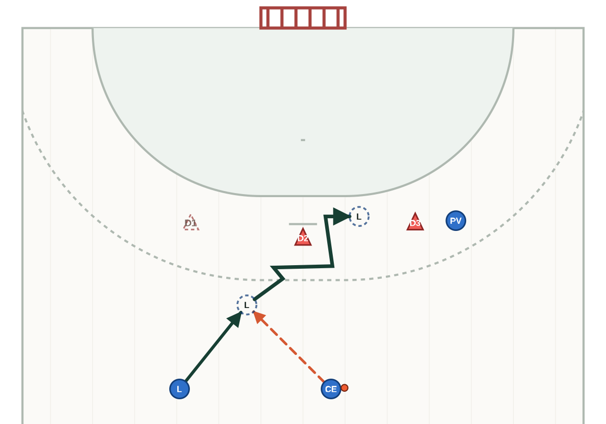

# Comparació visual de geometria v0.3 → v0.4

Les imatges de l'esquerra són còpies exactes del commit de referència
`06b4c88`; les de la dreta són els SVG regenerats pel resolver v0.4. Tots els
fitxers són SVG independents i es poden obrir al navegador.

[Obre la comparació visual completa](comparison.html).

## A1 — passada i recepció

| v0.3 | v0.4 |
|---|---|
| [Obre l'SVG anterior](comparison/a1-pass-reception-v0.3.svg)  | [Obre l'SVG nou](a1-pass-reception.svg)  |

La vista nova retalla espai vertical mort, representa B1 una sola vegada i
manté cursa, passada i recepció en un mateix estat.

## A2 — recepció, finta i 2x1

| v0.3 | v0.4 |
|---|---|
| [Obre l'SVG anterior](comparison/a2-reception-feint-2x1-v0.3.svg)  | [Obre l'SVG nou](a2-reception-feint-2x1.svg)  |

La finta nova fa visibles compromís, trencament, separació de l'oponent i
sortida fora de l'àrea. El 2x1 es deriva de l'acció predecessora i el
delimitador implícit es mostra només com a referència contextual.

## A3 — variant al costat oposat

| v0.3 | v0.4 |
|---|---|
| [Obre l'SVG anterior](comparison/a3-opposite-side-v0.3.svg)  | [Obre l'SVG nou](a3-opposite-side.svg)  |

A3 verifica la mateixa resolució al costat contrari: les relacions, i no
l'ordre dels participants ni els identificadors, governen la disposició.

## Abast de la comprovació

- A1–A3 són renderitzables i passen la validació geomètrica automàtica v0.4.
- Els llindars i la lectura tàctica són provisionals fins a validació explícita
  de l'entrenador.
- No es genera cap passada o llançament final que el text no hagi declarat.
