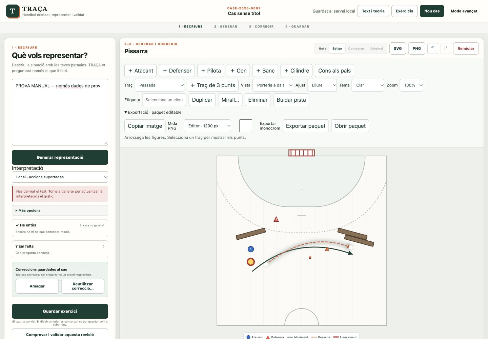
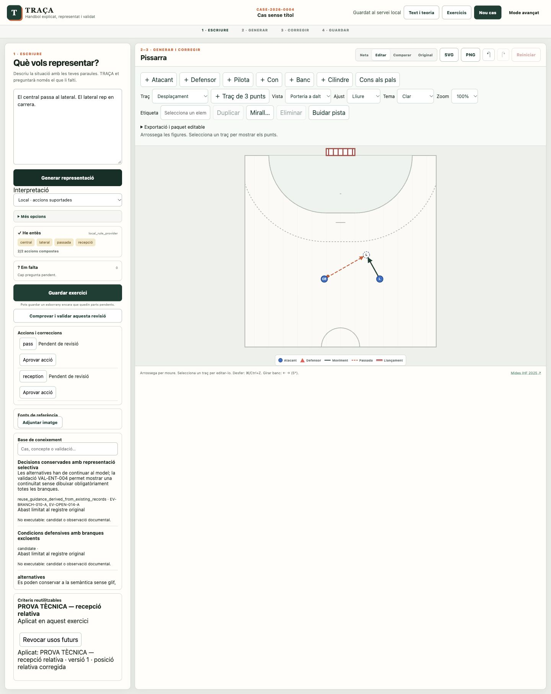
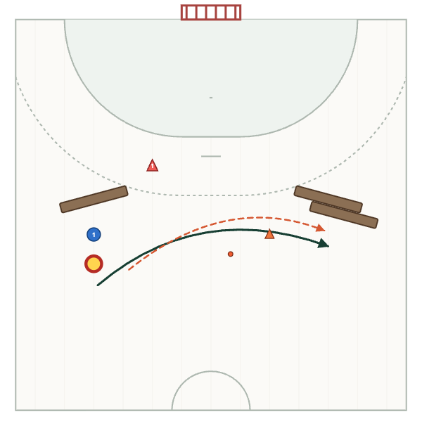

# TRAÇA — resultats de la revisió 2

Implementació funcional de la pissarra prioritària, persistència SQLite local, exportació neta, regeneració amb revisió i aprenentatge tipat. Es conserven el corpus i les aprovacions tàctiques prèvies; les aprovacions de les proves no són coneixement tàctic nou.

Resultat executable: **286 proves passades**, 0 fallades; validació semàntica amb sortida 0. **20/20 fonts originals** coincideixen amb els SHA-256 del paquet; cap font inaccessible. Els quatre defectes del script de revisió ja no es reprodueixen.

## Obrir l'aplicació

Des del directori CODEX:

```sh
python3 scripts/workspace_server.py --port 8000
```

Obre http://127.0.0.1:8000/. No obris index.html amb file://: la persistència durable necessita el servei. Alternativa: `make interface`. Python 3.11+; el servei és de biblioteca estàndard. La base és `.traca-data/workspace.sqlite3` (ignorada per Git). Guarda aquest fitxer amb el servei aturat si vols una còpia de seguretat; els paquets editables són una altra via portable.

El servei de lliurament no carrega criteris de prova ni un model fictici. Sense model configurat pots crear i editar la pissarra, guardar, importar i exportar. Si uses el proxy, la clau viu només al servidor; consulta `docs/GRAPHICS_ENGINE.md`. Connexió amb model remot real no verificada perquè no hi ha credencials.

## Comprovar els circuits

- A: Pissarra manual → afegir les sis figures → corba/passada → moure els tres controls → banc 10° i atall 5° → duplicar/simetria → desfer/refer → guardar → recarregar → exportar PNG/SVG.
- B: Text A1/A2/A3 → generar → seleccionar la recepció futura i moure-la → revisar dependències → regenerar → comparar i escollir cada conflicte o cancel·lar.
- C: Correcció → registrar criteri → revisar condicions/efecte/abast → aprovar → cas nou compatible → comprovar font i canvi real → revocar. No aprovis una fixture tècnica com a consigna esportiva.

Les observacions reals i els passos no observats són a [browser-observations.json](browser-observations.json). Les captures precedeixen alguns ajustos finals; no s'ha fingit una repetició UI quan es va perdre el navegador controlable.

## Acceptació individual

`verificat` = contracte executat i evidència indicada; `parcial` = part executada, limitació concreta. No equival a homologació en tots els dispositius.

| ID | Estat | Evidència / límit |
| --- | --- | --- |
| ED01 | parcial | Tacte físic i mòbil pendents. Proves: test_ed_atomic_undo_redo_roundtrip_for_all_manual_operations, test_ed_pointer_capture_offset_final_up_cancel_and_keyboard_guard, test_ed_transform_is_frozen_for_pointer_session_even_if_selection_changes_layout. UI: A_MANUAL |
| ED02 | parcial | Corba sencera lliure no repetida a la UI després de l'últim ajust. Proves: test_ed_quadratic_shared_endpoints_snap_and_clone_graph, test_ed_pointer_capture_offset_final_up_cancel_and_keyboard_guard. UI: A_MANUAL, B_A1 |
| ED03 | parcial | Nansa de gir pendent de repetició UI; botons i atall observats. Proves: test_ed_atomic_undo_redo_roundtrip_for_all_manual_operations, test_ed_copy_remaps_actions_ball_offset_and_delete_exposes_broken_relation. UI: A_MANUAL |
| ED04 | parcial | Desfer/refer regeneració comprovat automàticament, no tot el circuit UI mixt. Proves: test_ed_atomic_undo_redo_roundtrip_for_all_manual_operations, test_gn_three_way_regeneration_preserves_edits_conflicts_late_and_undo, test_gn_failed_acceptance_is_retryable_and_case_open_cancels_old_response. UI: A_MANUAL |
| ED05 | verificat | Zoom, mitja pista superior/inferior i pista completa. Proves: test_ed_transform_is_frozen_for_pointer_session_even_if_selection_changes_layout, test_ge_full_court_bottom_area_and_scoped_action_approval. UI: A_VIEW |
| ED06 | parcial | Snap cobert pel contracte geomètric; ús tàctil i UI no repetits. Proves: test_ed_quadratic_shared_endpoints_snap_and_clone_graph. UI: no repetida |
| ED07 | parcial | Cancel·lació/pèrdua de captura cobertes automàticament. Proves: test_ed_pointer_capture_offset_final_up_cancel_and_keyboard_guard, test_ed_transform_is_frozen_for_pointer_session_even_if_selection_changes_layout. UI: A_MANUAL |
| SV01 | verificat | Guardar manual i automàtic, tancar, reiniciar servei i recuperar en sessió nova. Proves: test_sv_sqlite_restart_revision_conflicts_and_exact_backups, test_http_durable_recovery_conflict_and_historical_versions. UI: DURABLE_RESTART |
| SV02 | parcial | Desconnexió/quota cobertes amb doble client, conflicte amb servei real. Proves: test_sv_client_offline_recovers_and_conflict_never_claims_saved, test_http_durable_recovery_conflict_and_historical_versions. UI: TWO_SESSIONS |
| SV03 | parcial | Migració real idempotent i backup exercitats; importació via UI pendent. Proves: test_sv_all_package_versions_open_without_implicit_approval[0.2.0], test_sv_all_package_versions_open_without_implicit_approval[0.3.0], test_sv_all_package_versions_open_without_implicit_approval[0.4.0], test_sv_all_package_versions_open_without_implicit_approval[0.5.0], test_sv_all_package_versions_open_without_implicit_approval[0.6.0], test_sv_sqlite_restart_revision_conflicts_and_exact_backups. UI: no repetida |
| SV04 | verificat | Guardar cas incomplet sense aprovar-lo. Proves: test_sv_stale_incomplete_drafts_and_revision_scoped_approval, test_ge_full_court_bottom_area_and_scoped_action_approval. UI: A_MANUAL |
| EX01 | parcial | PNG real inspeccionat; baixada SVG UI no confirmada. Proves: test_ex_clean_export_dimensions_unique_ids_and_temporal_legend, test_ed_temporal_state_has_hitbox_only_in_edit_view. UI: CLEAN_PNG |
| EX02 | parcial | Imatge real copiada; alternativa PNG preparada, baixada no confirmada. Proves: test_ex_png_failures_clipboard_image_and_honest_fallback_release_urls. UI: CLEAN_PNG |
| EX03 | parcial | Roundtrip automatitzat; importació i monocrom a UI pendents. Proves: test_ed_atomic_undo_redo_roundtrip_for_all_manual_operations, test_ex_clean_export_dimensions_unique_ids_and_temporal_legend, test_sv_real_edited_package_and_corrections_satisfy_portable_schema. UI: CLEAN_PNG |
| TH01 | parcial | Selecció d'acció observada; totes les ambigüitats bidireccionals no repetides. Proves: test_th_confirmed_model_keeps_selectable_provisional_theory, test_ge_full_court_bottom_area_and_scoped_action_approval. UI: B_MODEL, B_A1 |
| TH02 | parcial | Pissarra independent observada; càrrega d'imatge de referència pendent de circuit UI. Proves: test_sv_stale_incomplete_drafts_and_revision_scoped_approval, test_sv_real_edited_package_and_corrections_satisfy_portable_schema. UI: A_MANUAL |
| GN01 | parcial | Només famílies inicials compatibles, no generació universal. Proves: test_a1_pass_and_reception_resolve_without_input_coordinates, test_a2_demo_preserves_identity_ball_spaces_and_open_2x1, test_a3_identifier_and_side_variants_use_relations_not_templates[False], test_a3_identifier_and_side_variants_use_relations_not_templates[True], test_a2_and_explicit_opposite_side_are_geometric_mirrors, test_ge_full_curves_stationary_and_feint_sequence. UI: B_A1, B_A2, B_A3 |
| GN02 | verificat | Moure recepció compartida i portador. Proves: test_ed_quadratic_shared_endpoints_snap_and_clone_graph, test_ed_copy_remaps_actions_ball_offset_and_delete_exposes_broken_relation. UI: B_A1 |
| GN03 | parcial | Correccions mixtes, respostes tardanes i undo provats automàticament; circuit UI complet pendent. Proves: test_gn_three_way_regeneration_preserves_edits_conflicts_late_and_undo, test_gn_derived_validation_is_not_a_coach_regeneration_conflict, test_gn_failed_acceptance_is_retryable_and_case_open_cancels_old_response. UI: B_MODEL |
| LR01 | parcial | Aprovació de prova explícita, no autoritat tàctica del corpus. Proves: test_lr_typed_criterion_new_ids_positions_mirror_and_negative_cases, test_sv_real_edited_package_and_corrections_satisfy_portable_schema. UI: C_LEARNING |
| LR02 | parcial | Cas nou UI observat; IDs/posicions nous i mirall verificats amb demo executable. Proves: test_lr_typed_criterion_new_ids_positions_mirror_and_negative_cases. UI: C_LEARNING |
| LR03 | parcial | Revocació observada; incompatibilitat i conflicte de regles exercitats automàticament. Proves: test_lr_typed_criterion_new_ids_positions_mirror_and_negative_cases, test_lr_result_constraints_feint_binding_and_revocation_reopen. UI: C_LEARNING |
| LR04 | parcial | Contracte automàtic: aprovat sense executor no es declara aplicat. Proves: test_lr_typed_criterion_new_ids_positions_mirror_and_negative_cases, test_lr_result_constraints_feint_binding_and_revocation_reopen. UI: no repetida |
| KB01 | verificat | Carregar JSON 0.2.0 real i consultar VAL-ENT-004. Proves: test_kb_real_index_validation_scope_counts_and_selective_activation. UI: no repetida |
| KB02 | parcial | Catàleg mapejat individualment; no es declaren T01–T20 tots executats. Proves: test_kb_real_index_validation_scope_counts_and_selective_activation, test_kb_activation_changes_only_optional_view_and_preserves_branches. UI: no repetida |
| GE01 | verificat | Reproduir atacant immòbil dins l’àrea i corba que hi entra. Proves: test_ge_full_curves_stationary_and_feint_sequence, test_ge_full_court_bottom_area_and_scoped_action_approval. UI: no repetida |
| GE02 | verificat | Comprovar finta d’A2/A3 sobre ordre i costat del creuament de la línia de D2. Proves: test_ge_full_curves_stationary_and_feint_sequence. UI: B_A2, B_A3 |
| VS01 | parcial | 14 símbols i estats provats; comparació humana completa color/monocrom pendent. Proves: test_visual_dictionary_v02_validates_and_has_exactly_fourteen_canonical_symbols, test_symbol_sheet_uses_all_canonical_references_and_is_readable_without_color, test_ex_clean_export_dimensions_unique_ids_and_temporal_legend, test_ed_temporal_state_has_hitbox_only_in_edit_view, test_pass_display_is_trimmed_to_symbols_without_mutating_resolved_geometry. UI: CLEAN_PNG |
| RG01 | parcial | 15 fonts preservades; 46 escenes parcials en 12 casos, 0 exercicis complets pel compositor genèric. Proves: test_rg_corpus_qualitative_scenes_preserve_full_sources_and_separate_balls, test_kb_activation_changes_only_optional_view_and_preserves_branches. UI: no repetida |
| UI01 | parcial | Circuits principals A–C observats; variants enumerades a browser-observations.json encara pendents. Proves: test_ed_atomic_undo_redo_roundtrip_for_all_manual_operations, test_lr_typed_criterion_new_ids_positions_mirror_and_negative_cases, test_http_durable_recovery_conflict_and_historical_versions. UI: A_MANUAL, B_A1, B_A2, B_A3, C_LEARNING, DURABLE_RESTART, TWO_SESSIONS, CLEAN_PNG |

## Catàleg T01–T20

La font conté especificacions, no vint proves ja executades. Es conserva intacta. Aquesta taula separa la fixture externa exacta dels contractes equivalents parcials del motor.

| ID | Especificació | Estat | Abast executat / pendent |
| --- | --- | --- | --- |
| T01 | Traducció de llegendes | pendent | No s'ha implementat el lector visual de llegendes externes S06/S09. |
| T02 | Recepció compartida i possessió | parcial | Recepció única/possessió A1 i dependències; no seqüència externa D02 e2–e6 completa. |
| T03 | Identitat persistent | parcial | Identitats persistents/còpia de graf; D08 A1/A1_F no traduït completament. |
| T04 | Variant versus seqüència | parcial | Variants/fonts no aplanades; selector V_BASE del cas extern D03 pendent. |
| T05 | Informació no determinada | parcial | Buits conservats i cap geometria forçada; adaptació completa D08 pendent. |
| T06 | Desencadenament sense ordre total inventat | pendent | Motor de desencadenaments externs A_prepares_pass no implementat. |
| T07 | Repeticions que se solapen | pendent | Planificació de repeticions solapades amb recursos no implementada. |
| T08 | Inventari de pilotes | parcial | Pilotes i holder separats; inventari/activació de repeticions D01 pendents. |
| T09 | Recompte local | parcial | 2x1 local inicial; suport/porter del cas extern D06 no traduït completament. |
| T10 | Camins condicionals excloents | parcial | Decisions preservades; execució de tots els camins externs D04 pendent. |
| T11 | Dos N3 i un interval relatiu | pendent | Intervals derivats dels dos delimitadors N3 externs no implementats. |
| T12 | Final imposat només dins aquella tasca | parcial | 2x1 obert no força PV; comparativa externa D04/D06 pendent. |
| T13 | Reflexió i mà dominant | parcial | Reflexió relacional/IDs i criteri mirall; no traducció externa D02/D05 completa. |
| T14 | Bloqueig ofensiu tipat | parcial | Accions tipades originals preservades; adaptador screen de D07 pendent. |
| T15 | Intercanvi d’assignacions | pendent | Intercanvi d'assignacions defensives de D07 no resolt. |
| T16 | Geometria amb incertesa | parcial | No exigeix coordenades d'entrada ni les promou a semàntica; layout extern D10 pendent. |
| T17 | Escenes independents | parcial | Subescenes separades del corpus; F60/F33 externs encara sense adaptador complet. |
| T18 | Funció dels cons | parcial | Funció material original preservada; C_BOUNDARY D04 extern pendent. |
| T19 | Evidència no equival a promoció | verificat | JSON real: candidates inoperants, runtime_import_allowed false i validacions prèvies selectives amb abast. |
| T20 | Intersecció sense operador tàctic | parcial | No s'infereix tàctica de píxels/interseccions; trajectòries externes D08 no resoltes completament. |

## Corpus: denominadors i resultats

46 escenes de flux de pilota realment resoltes, en 12/15 exercicis. **0/15 exercicis complets** amb el compositor genèric. La geometria canònica UVOF015 és un espècimen separat: no s'utilitza per inflar aquesta cobertura.

| Exercici | Escenes | Estat complet | Operadors o informació pendent |
| --- | ---: | --- | --- |
| TR-UVOF-001 | 2 | partial | Falta adaptar el marc relacional recepcio a l’operador (origen, destí, referència i condició); la geometria es deriva de relacions qualitatives.; Falta adaptar el marc relacional finta a l’operador (origen, destí, referència i condició); la geometria es deriva de relacions qualitatives.; La decisió conserva passada/llançament/continuïtat oberts.; Falta adaptar el marc relacional recuperacio_sense_pilota a l’operador (origen, destí, referència i condició); la geometria es deriva de relacions qualitatives.; Falta adaptar el marc relacional atac_espai a l’operador (origen, destí, referència i condició); la geometria es deriva de relacions qualitatives.; Operador no implementat: resolucio |
| TR-UVOF-002 | 8 | partial | Falta adaptar el marc relacional atac_espai a l’operador (origen, destí, referència i condició); la geometria es deriva de relacions qualitatives.; Falta adaptar el marc relacional recepcio a l’operador (origen, destí, referència i condició); la geometria es deriva de relacions qualitatives.; Falta adaptar el marc relacional finta a l’operador (origen, destí, referència i condició); la geometria es deriva de relacions qualitatives.; Falta adaptar el marc relacional continuitat a l’operador (origen, destí, referència i condició); la geometria es deriva de relacions qualitatives.; Falta adaptar el marc relacional encreuament a l’operador (origen, destí, referència i condició); la geometria es deriva de relacions qualitatives.; Falta adaptar el marc relacional ajust_sense_pilota a l’operador (origen, destí, referència i condició); la geometria es deriva de relacions qualitatives.; La decisió conserva passada/llançament/continuïtat oberts.; Operador no implementat: resolucio |
| TR-UVOF-003 | 3 | partial | PASS_BINDING_UNRESOLVED: autoritat_validada; Falta adaptar el marc relacional atac_espai a l’operador (origen, destí, referència i condició); la geometria es deriva de relacions qualitatives.; Falta adaptar el marc relacional ajust_sense_pilota a l’operador (origen, destí, referència i condició); la geometria es deriva de relacions qualitatives.; Falta adaptar el marc relacional continuitat a l’operador (origen, destí, referència i condició); la geometria es deriva de relacions qualitatives.; Falta adaptar el marc relacional encreuament a l’operador (origen, destí, referència i condició); la geometria es deriva de relacions qualitatives.; La decisió conserva passada/llançament/continuïtat oberts.; Operador no implementat: resolucio |
| TR-UVOF-004 | 6 | partial | Falta adaptar el marc relacional ajust_sense_pilota a l’operador (origen, destí, referència i condició); la geometria es deriva de relacions qualitatives.; La decisió conserva passada/llançament/continuïtat oberts.; Falta adaptar el marc relacional continuitat a l’operador (origen, destí, referència i condició); la geometria es deriva de relacions qualitatives.; Operador no implementat: resolucio |
| TR-UVOF-005 | 0 | needs_operator_adapter | Falta adaptar el marc relacional ajust_sense_pilota a l’operador (origen, destí, referència i condició); la geometria es deriva de relacions qualitatives.; Falta adaptar el marc relacional atac_espai a l’operador (origen, destí, referència i condició); la geometria es deriva de relacions qualitatives.; La decisió conserva passada/llançament/continuïtat oberts.; No hi ha flux passador–receptor–pilota validat en aquest contracte; la situació completa requereix adaptar els seus operadors.; Operador no implementat: resolucio |
| TR-UVOF-006 | 7 | partial | PASS_BINDING_UNRESOLVED: autoritat_validada; Falta adaptar el marc relacional atac_espai a l’operador (origen, destí, referència i condició); la geometria es deriva de relacions qualitatives.; La decisió conserva passada/llançament/continuïtat oberts.; Falta adaptar el marc relacional continuitat a l’operador (origen, destí, referència i condició); la geometria es deriva de relacions qualitatives.; Falta adaptar el marc relacional encreuament a l’operador (origen, destí, referència i condició); la geometria es deriva de relacions qualitatives.; Falta adaptar el marc relacional recepcio a l’operador (origen, destí, referència i condició); la geometria es deriva de relacions qualitatives.; Operador no implementat: resolucio |
| TR-UVOF-007 | 0 | needs_operator_adapter | Falta adaptar el marc relacional encreuament a l’operador (origen, destí, referència i condició); la geometria es deriva de relacions qualitatives.; La decisió conserva passada/llançament/continuïtat oberts.; Falta adaptar el marc relacional recuperacio_sense_pilota a l’operador (origen, destí, referència i condició); la geometria es deriva de relacions qualitatives.; Falta adaptar el marc relacional ajust_sense_pilota a l’operador (origen, destí, referència i condició); la geometria es deriva de relacions qualitatives.; No hi ha flux passador–receptor–pilota validat en aquest contracte; la situació completa requereix adaptar els seus operadors.; Operador no implementat: resolucio |
| TR-UVOF-008 | 1 | partial | Falta adaptar el marc relacional ajust_sense_pilota a l’operador (origen, destí, referència i condició); la geometria es deriva de relacions qualitatives.; Falta adaptar el marc relacional atac_espai a l’operador (origen, destí, referència i condició); la geometria es deriva de relacions qualitatives.; La decisió conserva passada/llançament/continuïtat oberts.; Falta adaptar el marc relacional encreuament a l’operador (origen, destí, referència i condició); la geometria es deriva de relacions qualitatives.; Operador no implementat: resolucio |
| TR-UVOF-009 | 4 | partial | Falta adaptar el marc relacional ajust_sense_pilota a l’operador (origen, destí, referència i condició); la geometria es deriva de relacions qualitatives.; Falta adaptar el marc relacional recepcio a l’operador (origen, destí, referència i condició); la geometria es deriva de relacions qualitatives.; Falta adaptar el marc relacional atac_espai a l’operador (origen, destí, referència i condició); la geometria es deriva de relacions qualitatives.; La decisió conserva passada/llançament/continuïtat oberts.; Operador no implementat: resolucio |
| TR-UVOF-010 | 3 | partial | Falta adaptar el marc relacional ajust_sense_pilota a l’operador (origen, destí, referència i condició); la geometria es deriva de relacions qualitatives.; Falta adaptar el marc relacional recepcio a l’operador (origen, destí, referència i condició); la geometria es deriva de relacions qualitatives.; Falta adaptar el marc relacional atac_espai a l’operador (origen, destí, referència i condició); la geometria es deriva de relacions qualitatives.; La decisió conserva passada/llançament/continuïtat oberts.; Operador no implementat: resolucio |
| TR-UVOF-011 | 2 | partial | Falta adaptar el marc relacional ajust_sense_pilota a l’operador (origen, destí, referència i condició); la geometria es deriva de relacions qualitatives.; Falta adaptar el marc relacional recepcio a l’operador (origen, destí, referència i condició); la geometria es deriva de relacions qualitatives.; Falta adaptar el marc relacional atac_espai a l’operador (origen, destí, referència i condició); la geometria es deriva de relacions qualitatives. |
| TR-UVOF-012 | 3 | partial | PASS_BINDING_UNRESOLVED: autoritat_validada; Falta adaptar el marc relacional ajust_sense_pilota a l’operador (origen, destí, referència i condició); la geometria es deriva de relacions qualitatives.; Falta adaptar el marc relacional recepcio a l’operador (origen, destí, referència i condició); la geometria es deriva de relacions qualitatives.; Falta adaptar el marc relacional atac_espai a l’operador (origen, destí, referència i condició); la geometria es deriva de relacions qualitatives.; La decisió conserva passada/llançament/continuïtat oberts.; Operador no implementat: resolucio |
| TR-UVOF-013 | 1 | partial | PASS_BINDING_UNRESOLVED: autoritat_validada; Falta adaptar el marc relacional ajust_sense_pilota a l’operador (origen, destí, referència i condició); la geometria es deriva de relacions qualitatives.; Falta adaptar el marc relacional recepcio a l’operador (origen, destí, referència i condició); la geometria es deriva de relacions qualitatives.; Falta adaptar el marc relacional atac_espai a l’operador (origen, destí, referència i condició); la geometria es deriva de relacions qualitatives.; La decisió conserva passada/llançament/continuïtat oberts.; Operador no implementat: resolucio |
| TR-UVOF-014 | 0 | needs_operator_adapter | PASS_BINDING_UNRESOLVED: autoritat_validada; Falta adaptar el marc relacional ajust_sense_pilota a l’operador (origen, destí, referència i condició); la geometria es deriva de relacions qualitatives.; Falta adaptar el marc relacional recepcio a l’operador (origen, destí, referència i condició); la geometria es deriva de relacions qualitatives.; Falta adaptar el marc relacional atac_espai a l’operador (origen, destí, referència i condició); la geometria es deriva de relacions qualitatives.; No hi ha flux passador–receptor–pilota validat en aquest contracte; la situació completa requereix adaptar els seus operadors. |
| TR-UVOF-015 | 6 | partial | Falta adaptar el marc relacional recuperacio_sense_pilota a l’operador (origen, destí, referència i condició); la geometria es deriva de relacions qualitatives.; Falta adaptar el marc relacional recepcio a l’operador (origen, destí, referència i condició); la geometria es deriva de relacions qualitatives.; La decisió conserva passada/llançament/continuïtat oberts.; Falta adaptar el marc relacional finta a l’operador (origen, destí, referència i condició); la geometria es deriva de relacions qualitatives.; Operador no implementat: resolucio |

Els layouts parcials són inferències visuals provisionals; no satisfan totes les zones, fases o condicionals del cas original. El paquet de cada subescena conserva la semàntica i el contracte originals complets. L'absència de coordenades d'entrada no s'utilitza com a diagnòstic de bloqueig.

## Exemple executable del segon cas

[criterion-result.json](demo/criterion-result.json): criteri relatiu de recepció, nou TacticalIR amb IDs CE/L/B1/A001/A002 renombrats i posicions inicials diferents; efecte observable i mirall relacional. Candidat sense aprovació i criteri revocat no operen. Autor: TEST_FIXTURE_NOT_COACH.

- [Abans](demo/second-before.svg), [després](demo/second-after.svg), [mirall](demo/mirror-after.svg).
- [Paquet origen editable](demo/source-training-case.json) i [segon cas editable](demo/second-training-case.json).
- [Captura del segon cas a l'app](screenshots/criterion-second-case.jpg).

## Captures i exportació reals







Altres captures: [A2](screenshots/a2-generated.jpg), [A3](screenshots/a3-generated.jpg), [model tècnic confirmat](screenshots/model-confirmed.jpg), [conflicte de desament](screenshots/save-conflict.jpg). No són les imatges de baseline incloses al ZIP.

## Decisions i límits

- Geometria, semàntica i render separats; cap canvi tàctic introduït per fer passar proves. Política visual provisional explícita. Material no es converteix en defensor sense funció declarada.
- Historial atòmic de 50 passos; drafts incomplets/geomètricament invàlids guardables, no aprovables implícitament. Eliminar referències trencades les conserva com a diagnòstics; encara no hi ha una previsualització d'impacte abans d'eliminar.
- SQLite local amb revisions, backups idempotents i conflicte 409 sense sobreescriptura silenciosa. No és servei remot multiusuari. Revisions històriques recuperables per API/UI.
- Revocacions conegudes no tornen a executar-se en reobrir un paquet antic. No hi ha un registre global de revocacions entre sessions independents que no s'hagin sincronitzat.
- Executor inicial: posició relativa vinculada i comprovació de finta. Criteris sense executor romanen aprovats però pendents, mai aplicats fictíciament. No s'executa codi arbitrari dels criteris.
- Cobertura automàtica inicial de passada/recepció/finta/2x1 obert. Convé l'entrenador per les ambigüitats tàctiques i adaptar més marcs relacionals; l'editor manual no depèn d'això.
- Tacte físic/mòbil, tots els passos UI enumerats i connexió a model real pendents. Porta-retalls verificat amb PNG real; baixada d'arxius UI no confirmada.

## Reproduir les proves

```sh
python3 -m pip install -r requirements.txt
python3 scripts/validate_semantic.py
python3 -m pytest -q --junitxml=reports/revision2/pytest.xml
node scripts/build_revision2_demo.js
python3 scripts/build_revision2_report.py --node node
```

Cal Node disponible per les proves JS. En aquest entorn s'ha utilitzat el Python de `/private/tmp/traca-integral-venv` i el Node bundled de Codex. Les proves HTTP han obert serveis loopback reals. [JUnit](pytest.xml), [validació semàntica](semantic-validation.txt), [defectes reproduïts](reproduced-findings.json), [integritat de fonts](source-integrity.json), [resultats estructurats](acceptance.json).
